 

  

 

<table align="center" width="100%">
  <tr>
    <td width="50%" valign="top">
      <h3 align="center">⟦ WHAT I DO ⟧</h3>
      <pre>
┌─ CORE ─────────────────────────┐
│ Python · logic architecture    │
│ deep code-execution thinking   │
├─ ORCHESTRATION ────────────────┤
│ custom UI/UX concepts →        │
│ high-precision technical       │
│ prompts → exact builds         │
├─ DELIVERY ─────────────────────┤
│ clean, custom, professional    │
│ web apps that never look       │
│ AI-generated                   │
└────────────────────────────────┘</pre>
    </td>
    <td width="50%" valign="top" align="center">
      <h3>⟦ STACK ⟧</h3>
       
       
       
      
       
      
      
      
    </td>
  </tr>
</table>

 

  

  

